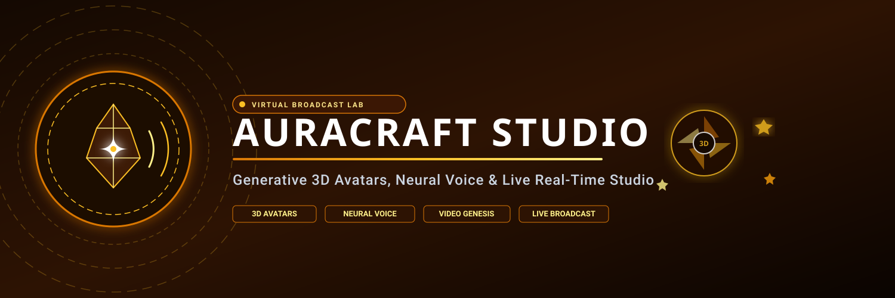

  

  
  
  
  
  
  

---

  <strong>A browser-based creative studio for 3D avatar creation, voice narration, AI video generation, and live broadcasting.</strong>

  3D avatars · voice · video · live broadcasting

---

  
  &nbsp;
  

